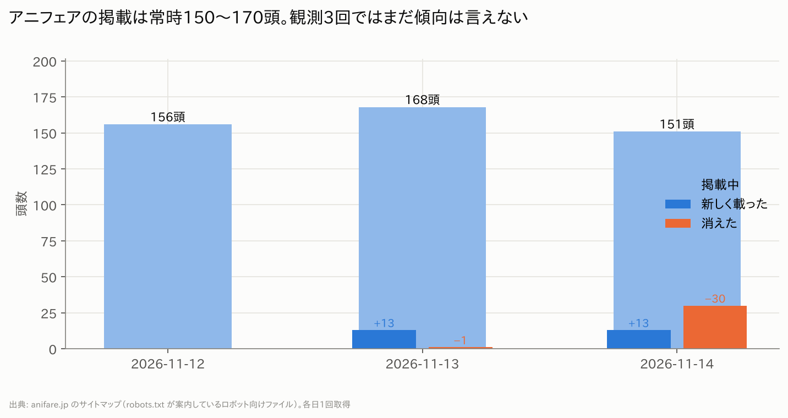
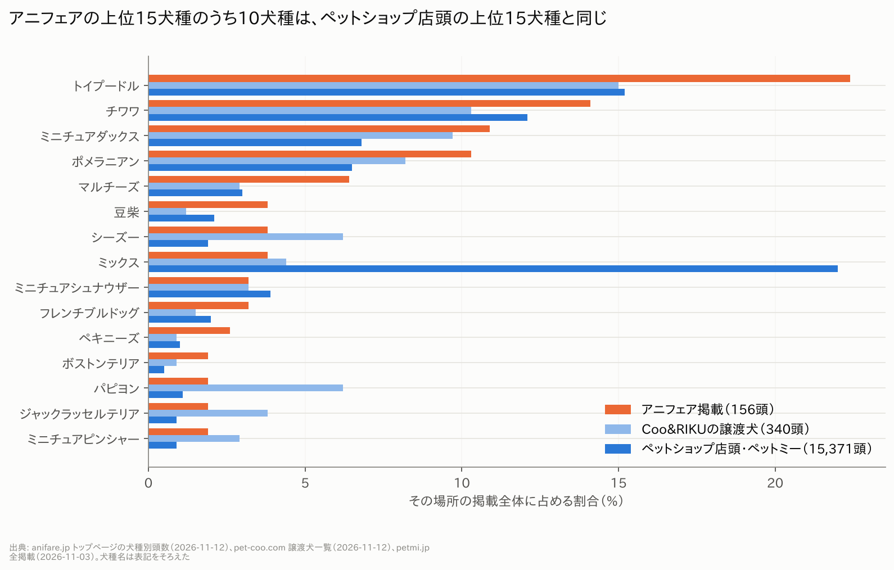
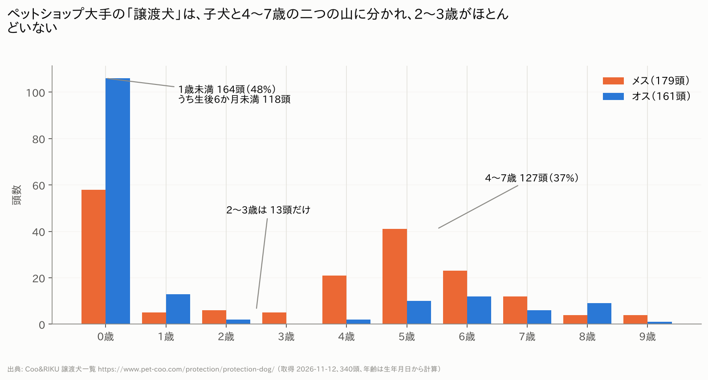

# アニフェア（anifare）調査レポート　第1版

作成日：2026-11-14　／　データ取得日：2026-11-12〜14　／　置き場所：`pet-data/anifare/`

このレポートは「今できること」だけで作った第1版です。週ごとの観測がたまるにつれて、滞留日数などの数字が増えていきます。

---

## 0. できたこと・できなかったこと

### できたこと
1. **アニフェアの掲載数の定点観測を開始**（11/12・11/13・11/14 の3回）。サイトがロボット向けに公開しているサイトマップだけを読む方式です。毎週月曜に自動で続きます。
2. **比較対象：Coo&RIKU の「譲渡犬」340頭**を取得（犬種・性別・生年月日・店舗）。
3. **犬種ランキングの比較**：アニフェア（156頭）／Coo&RIKU譲渡（340頭）／ペットショップ店頭（ペットミー 15,371頭）。
4. **法人情報**：国税庁・gBizINFO・東京都の公開情報で、5法人の法人番号・所在地・商号変更の履歴を確認。
5. **動物取扱業の表記**：7拠点分を原文のまま取得。
6. **月額サービス・フード・保険の提供元**：サイト上の表記と約款PDFから特定。
7. **公式の数字**（累計譲渡、月間506組、97%）の出典ページと時点を特定。
8. **現在の費用ページの文言**を取得。

### できなかったこと
| 項目 | 理由 | 次の手 |
|---|---|---|
| 1頭ごとの年齢・性別・体重・出どころ（タスク1の中身） | アニフェアの利用規約が「スクレイピングなど本サイト上の情報を不適切な方法で取得する行為」を禁止。個別ページの取得を途中で中止し、データは保存していない | サイトが配信しているRSSフィードなら同じ項目が取れる。海斗さんの「RSS OK」待ち |
| 出どころの割合（公式60〜70%との比較） | 同上 | 同上 |
| 年齢のヒストグラム・性別比（アニフェア分） | 同上 | 同上 |
| 滞留日数の分布 | 観測がまだ3日分。指示書どおり4週たまってから | 自動で蓄積中 |
| ペットのおうち | アクセス自体がブロックされた（Cloudflare）。回避していない | 取らない |
| OMUSUBI | 利用規約が「データベース作成目的のダウンロード・ロボットの利用」を禁止 | 取らない |
| いつでも里親募集中 | 規約が「複製・転載」を禁止。統計目的が当たるか不明 | 判断待ち |
| 費用ページの過去の変遷（Wayback） | この環境から web.archive.org に接続できない。存在するスナップショットの日付だけ分かった | 海斗さんのブラウザで開けば読める（URL一覧あり） |
| 決算公告 | 5法人とも見つからなかった（gBizINFO、官報決算DB、公式サイト、東京都NPOポータルを確認） | 登記簿の取得、NPO法人の事業報告書（初年度は2026年12月期） |
| 代表者「原田康隆」の確認 | 公的な無料資料に代表者名が出ていない | 登記情報提供サービス（有料） |
| Googleマップの口コミ | 口コミ本文の読み込み経路が robots.txt の禁止パス。公式APIを使う方針に決定 | APIキー待ち（1拠点5件まで） |

### 手順上のミス（正直に書きます）
- アニフェアの利用規約を確認する前に、robots.txt だけを見て個別ページの取得を始めてしまいました。約120頭分を読んだところで規約に気づいて止め、**取得した中身は保存していません**。
- その取得中に、別の調査が同じサイトの固定ページ約20ページを読んでおり、「並列アクセスしない」に反する時間帯がありました。
- 図A1のアニフェアの犬種別頭数は、規約に気づく前に**トップページを1回見たときの表示**（「犬種から探す」の頭数）を使っています。

---

## 1. 掲載数の動き（事実）

| 取得日 | 掲載中 | 新しく載った | 消えた |
|---|---|---|---|
| 2026-11-12（木）20時 | 156頭 | — | — |
| 2026-11-13（金）14時 | 168頭 | 13頭 | 1頭 |
| 2026-11-14（土）22時 | 151頭 | 13頭 | 30頭 |

出典：anifare.jp のサイトマップ（各日1回取得）。データ：`clean/アニフェア_掲載数の推移.csv`、`panel.csv`

- 2日間で新規26頭、消えたのは31頭です。
- 金曜→土曜に30頭が一度に消えました。土日の譲渡会に向けて動いた可能性があります（推測）。曜日の偏りは1週間分たまれば確かめられます。
- **公式の数字との関係（まだ結論は出せません）**
  - 公式は「月間506組」（2026年10月実績）。1日あたり約17組です。
  - 2日間で消えたのは31頭（1日15.5頭）で、数字の大きさは近いです。ただし2日分では何も言えません。
  - 新規掲載は1日13頭（月換算390頭）で、506組より少ないです。サイトに載らないまま譲渡される子がいる可能性があります（推測）。
  - 各シェルターの受入頭数の合計は372頭（公式 /shelter/ の表記）ですが、サイトの掲載は150〜170頭です。
- 「97%が1ヶ月以内」の検証：11/12時点の掲載156頭のうち、サイトマップ上の最終更新日が30日より前だったのは4頭（最長112日前）。ただし「更新日」は掲載開始日ではないので、これは検証になりません。4週間後に実測で出します。

---

## 2. 犬種：ペットショップの店頭とどれだけ同じか（事実）

- アニフェアの上位15犬種のうち、**10犬種がペットショップ店頭（ペットミー）の上位15犬種と同じ**、11犬種がCoo&RIKU譲渡の上位15と同じです。
- 順位の相関は、店頭と0.72、Coo&RIKU譲渡と0.67（スピアマン、アニフェアに1頭以上いる24犬種）。
- 店頭の上位15犬種が、アニフェア掲載の85%を占めます。
- 上位4犬種（トイプードル、チワワ、ミニチュアダックス、ポメラニアン）は3か所とも同じ順番です。
- **仮説に反する数字**：ミックス犬は店頭では22%で1位ですが、アニフェアでは3.8%（6頭）、Coo&RIKU譲渡でも4.4%です。「店頭の売れ残りがそのまま流れている」なら、もっと多いはずです。繁殖を引退した親犬は純血種が多い、という説明のほうが合います（推測）。
- 雑種（野犬・地域の犬）が中心の行政の譲渡とは、まったく違う構成です。これは「出どころが繁殖・販売の流通」という団体自身の説明と合っています。

データ：`clean/犬種ランキング比較.csv`

---

## 3. 比較：Coo&RIKUの「譲渡犬」（事実）

出典：https://www.pet-coo.com/protection/protection-dog/ （取得 2026-11-12、340頭。サイトの表示は「今までに15,964頭の家族が決まりました」）

| 項目 | 数字 |
|---|---|
| 性別 | メス179頭（53%）、オス161頭（47%） |
| 1歳未満 | 164頭（48%）。うち生後6か月未満が118頭 |
| 2〜3歳 | 13頭（4%） |
| 4〜7歳 | 127頭（37%） |
| 4歳以上のメスの割合 | 72%（145頭中） |
| 1歳未満のメスの割合 | 35%（オスが65%） |
| 年齢の中央値 | 1.1歳 |

- **二つの山**がはっきりあります。子犬（売れなかった子とみられる）と、4〜7歳のメス（繁殖を引退した親とみられる）です。どちらも（推測）で、サイトに出どころの記載はありません。
- 2〜3歳がほとんどいないのは、「家庭で飼えなくなった犬」がほぼ入っていないことを示します（家庭由来なら年齢はばらけるはずです）。
- 費用（公式のよくある質問）：「譲渡負担金は0円です。諸経費等が必要となります」「譲渡犬猫ケアパック：総額47,070円（税込）」「3年間（1歳以上）もしくは5年間（1歳未満）…定期的にフードを送らせていただきます」「ペット保険に加入頂いております」。
- **アニフェアで同じ図を作れば**、6歳前後に山があるか、2〜4歳がどれだけいるかが一目で比べられます（RSSの承認待ち）。

データ：`compare/coo_protection_2026-11-12.csv`、`clean/CooRIKU譲渡_年齢1歳刻み.csv`

---

## 4. 費用と呼び名（現在の表記だけ。過去は未取得）

| 場所 | 呼び名・原文 | 金額 | 出典（取得 2026-11-12） |
|---|---|---|---|
| 各犬のページ | 「寄付金をお願いしています。※寄付金は任意であり保護犬の対価ではございません」 | 記載なし | https://anifare.jp/dogcat/702709/ |
| 費用ページ | ページ名「お迎え時の費用について」。項目は「活動支援金」「リコンディショニングパック」「お迎えセット」 | **記載なし**（「詳細はお問い合わせください」） | https://anifare.jp/fee/ |
| 同上 | 「保護犬に対する対価ではなく保護活動を維持・発展するためにご理解ご協力お願いします」「お迎えセットは必須ではございません」 | — | 同上 |
| 相談窓口 | 「寄付金が任意でなく、絶対条件と言われた」「毎月のフード購入が必須と言われた」場合は連絡を、という案内 | — | https://anifare.jp/support/ |
| 寄付ページ | 「寄付・ご支援」（譲渡時の費用とは別） | 2,000〜20,000円 | https://anifare.jp/donation/ |

- 同じサイトの中で、犬のページは「**寄付金**（任意）」、費用ページは「**活動支援金**」と、呼び名が違います。
- 現在の公式サイトには、譲渡時の金額がどこにも書かれていません。9.8万円・13.5万円・13.7万円などの数字は、今回読んだ範囲では確認できていません。
- 相談窓口のページは、「寄付は絶対条件と言われた」「フード購入が必須と言われた」という声があったことを、団体自身が前提にしている書き方です。
- 過去の変遷は Wayback Machine のスナップショット24件の存在だけ確認しました（`clean/Wayback_スナップショット一覧.csv`）。/fee/ は2025年6月より前のスナップショットがなく、このURLは2025年ごろに新設された可能性があります（推測）。

---

## 5. 法人関係（事実。出典は国税庁法人番号公表サイト・gBizINFO・東京都、取得 2026-11-12）

| 法人番号 | 名称 | 登記上の所在地 | 法人番号の指定日 | 変更履歴・補足 |
|---|---|---|---|---|
| 2011001127754 | 株式会社MILLE | 渋谷区広尾5-25-2 | 2019-04-26 | 2020-02-07「株式会社anifare」に商号変更 → 2023-12-28「株式会社MILLE」に戻す。社保の被保険者54人 |
| 8011005008904 | 一般社団法人アニマルウェルフェア東京 | **渋谷区広尾5-25-2**（MILLEと同じ。社保の事業所も同じ広尾AKビル8階） | 2021-02-10 | サイト上の所在地は八王子。被保険者7人 |
| 4120905006621 | 一般社団法人アニマルウェルフェア大阪 | 豊中市庄内栄町5-11-5 | 2024-06-21 | 被保険者2人 |
| 9290005019619 | 一般社団法人アニマルウェルフェア福岡 | 糟屋郡須惠町須恵973-1 | 2025-01-20 | 被保険者4人 |
| 9010105002353 | NPO法人anifare | 八王子市南浅川町4030 2階（東京シェルターと同じ） | 2025-11-26 | 都の認証 2025-11-04。理事長 坂口孝、副理事長 原健治 |

**時期の重なり**
| 日付 | 出来事 |
|---|---|
| 2019-04 | 株式会社MILLE 設立 |
| 2020-02 | 株式会社anifare に商号変更 |
| 2021-02 | 一般社団法人アニマルウェルフェア東京 設立（株式会社と同じ住所） |
| 2021-05 | 「保護犬譲渡事業を移管、非営利活動に転換」（公式の沿革） |
| 2021-08〜2022-03 | 大阪・福岡のシェルター開設（現地の社団ができる2〜3年前） |
| 2023-12 | 株式会社anifare → 株式会社MILLE に戻す |
| 2024-06／2025-01 | 大阪・福岡の一般社団法人 設立 |
| 2025-11 | NPO法人anifare 設立 |

**お金の流れに関わる点**
- 譲渡事業は一般社団法人に移っていますが、月額会員サービス「ani SUPPORT」の提供者は**株式会社MILLE**です（約款PDFの記載）。
- ani SUPPORT は月額2,900円（年38,280円税込）、1年自動更新、途中解約不可。旧約款（2020年12月）は月1,900円（年22,800円）で、**約1.5倍**になっています。
- 約款は「譲受契約に付随するサービス」としていますが、加入が必須とは書いていません。
- オンラインストアの個人情報保護方針には、今も旧商号の「株式会社anifare」が残っています。特定商取引法の表記に販売業者名がありません。
- 寄付の受領法人名はサイトに記載がありません。「所得控除対象団体ではございません」と明記されています。
- 従業員数：サイト上は「90名」。社保の被保険者は株式会社54人＋社団3法人13人＝67人で、**8割が株式会社側**です。

**サイト内の食い違い**
- 大阪の代表理事：/corporation/ では原健治、/about/ では松本華奈。
- 東京の開設時期：2020年10月30日と2021年4月の両方の記載。福岡のページにも東京と同じ「2020年10月30日にオープン」の文言。
- 勉強会の回数：/numbers/ は61回、/history/ は「2026年8月現在55回」。

**動物取扱業の表記**（`clean/動物取扱業の表記_拠点別.csv`）
- 番号があるのは7拠点中3拠点（八王子「5動相多 第422号」、お台場「5動相取第350号」、立川「8動相多 第271号」）。
- 大阪・大日・福岡・ももちは番号の記載がなく、大日は欄自体がありません。
- 種別は全拠点「譲渡し(二種)」で、第一種（営利）の表記はありません。登録年月日・有効期限・責任者はどこにも書かれていません。

---

## 6. 分析して出すもの：指示書の8項目の状況

| # | 項目 | 状況 |
|---|---|---|
| 1 | 出どころの割合（公式60〜70%と比較） | ❌ 未取得（RSSの承認待ち）。なお「60〜70%」は今回読んだ公式ページのどこにも数値がありませんでした |
| 2 | 性別比・年齢分布 | ❌ アニフェア分は未取得。比較用のCoo&RIKU分は完了（3章） |
| 3 | 犬種ランキング上位15と店頭との一致度 | ✅ 15犬種中10犬種が一致、順位相関0.72（2章） |
| 4 | 滞留日数の分布 | ⏳ 4週たまってから。観測は開始済み |
| 5 | 月あたりの新規掲載数 | ⏳ 2日分で月換算390頭。週次がたまってから確定 |
| 6 | 比較サイトとの差 | △ Coo&RIKU譲渡のみ。他3サイトは規約・ブロックで未取得 |
| 7 | 費用・呼び名の年表 | △ 現在の表記のみ。過去は未取得 |
| 8 | 法人関係の一覧表 | ✅ 5章 |

---

## 7. 動画で断定してよい数字／してはいけない数字

### 断定してよい（一次資料で確認済み。出典を画面に出すこと）
- 株式会社MILLEは2020年2月に「株式会社anifare」に、2023年12月に「MILLE」に商号を変えている（国税庁）。
- 一般社団法人アニマルウェルフェア東京の登記上の所在地は、株式会社MILLEと同じ渋谷区広尾5-25-2（国税庁、2026-11-12時点）。
- 月額会員サービス ani SUPPORT の提供者は株式会社MILLE、月額2,900円、途中解約不可（公式の約款・ページ）。旧約款は月1,900円。
- 公式サイトの費用ページには金額が書かれていない（2026-11-12時点）。
- 犬のページには「寄付金は任意であり保護犬の対価ではございません」、費用ページには「活動支援金」と書いてある。
- 公式の数字：累計31,527組、月間506組（2026年10月実績）、「97%が1ヶ月以内」（算定根拠の記載なし）。
- 動物取扱業の種別は全拠点「譲渡し(二種)」。番号の記載があるのは7拠点中3拠点。
- アニフェアの上位15犬種のうち10犬種は、ペットショップ店頭の上位15犬種と同じ（2026-11-12の掲載156頭）。
- Coo&RIKUの譲渡犬340頭は、1歳未満が48%、4〜7歳が37%、2〜3歳は4%（2026-11-12）。4歳以上の72%がメス。
- Coo&RIKUは「譲渡負担金0円、ケアパック47,070円、フード定期3〜5年」と公式に書いている。

### 断定してはいけない
- 「繁殖引退犬が60〜70%」：公式ページで数値を確認できていない。前提情報のまま使わない。
- 「アニフェアの譲渡費用は◯万円」「値上げした」：金額の一次資料がまだない。口コミと過去ページを取ってから。
- 「寄付は実質強制」：公式は「任意」と明記。相談窓口に「絶対条件と言われた場合は連絡を」とあるのは事実だが、強制の証拠ではない。
- 「97%は嘘」：検証はこれから。
- 「月506組は多すぎる／合わない」：2日分の観測では言えない。
- 「一般社団法人は名ばかりで、実態は株式会社」：住所の一致と月額サービスの提供者は事実だが、資金の流れ（決算）は確認できていない。
- 「Coo&RIKUの譲渡犬は売れ残りと引退犬」：年齢と性別の分布からの推測。サイトに出どころの記載はない。
- 「原田康隆が代表」：公的資料で未確認。
- 掲載数の2日間の増減からの月換算。

---

## 8. 次に取れる選択肢（判断は海斗さん）

| 選択肢 | 得られるもの | 手間・リスク |
|---|---|---|
| A. RSSフィードを使う | 全頭の生年月日・体重・避妊去勢・出どころの文。1〜2章の未取得がほぼ埋まる | 「配信物を読むのは規約の禁止に当たらない」は私の解釈。相手は違う読み方をするかもしれない |
| B. アニフェアに取材・許可を申し込む | 許可が出れば全項目。断られても「断られた」が記録になる | 返事待ち。調査していることが相手に伝わる |
| C. サイトマップだけで続ける（現状） | 掲載数、新規・消えた数、滞留日数、97%の検証 | 中身（年齢・出どころ）は分からない |
| D. 登記簿を取る（有料、1通数百円） | 代表者・役員・目的・公告方法。株式会社と社団の役員の重なり | 海斗さんが登記情報提供サービスで取得 |
| E. Waybackを海斗さんのブラウザで開く | 費用と呼び名の年表（24件のURL一覧あり） | 手作業。保存したHTMLを送ってもらえれば、こちらで年表にする |
| F. 東京都・大阪府・福岡県に、第二種動物取扱業の届出書を開示請求 | 届出の年月日、飼養頭数、責任者。定期報告（2020年6月以降義務）があれば年間の譲渡頭数 | 請求書の文面はこちらで作れる。数週間かかる |

---

## 9. チェック表（指示書の項目に答えたか）

| 指示書の項目 | 答えたか |
|---|---|
| タスク1：全件取得（1頭ごとの項目） | ❌ 規約により中止。RSSで代替可能（承認待ち） |
| タスク1：週次の定点観測（新規・消えた・滞留日数・30日以内の割合） | ⏳ 開始済み（サイトマップ方式、3回分）。滞留日数は4週後 |
| タスク2：比較サイト2〜3つ | △ 1つ（Coo&RIKU）。3つは取れない理由を報告。代替案はRSS方式の他団体・開示請求 |
| タスク3：Waybackの年表 | ❌ 接続不可。スナップショット一覧のみ |
| タスク4：法人番号・所在地・設立日・変更履歴 | ✅ |
| タスク4：所在地・時期の重なりの表 | ✅ |
| タスク4：決算公告 | ✅ 探した結果「見つからなかった」 |
| タスク4：動物取扱業申請情報（全拠点、原文） | ✅ |
| タスク4：月額会員・保険・フードの提供元 | ✅ 月額＝株式会社MILLE、フード＝共立製薬の協賛（ロイヤルカナン）、保険＝現行ページに記載なし（過去PDFにSBIプリズム少短のロゴ） |
| タスク5：Googleマップ口コミ | ❌ 禁止パスのため未取得。公式API方式に決定、キー待ち |
| 作法：3秒以上・並列なし | △ 3秒以上は守った。並列は一時的に破った（0章） |
| 作法：ログイン・非公開ページに触らない | ✅ |
| 作法：robots.txt の禁止パスは明記して判断を仰ぐ | ✅ |
| 作法：生HTMLを日付フォルダに保存 | ✅ `raw/`（サイトマップ、Coo&RIKU一覧）。中止したアニフェア個別ページは保存なし |
| 成果物：レポート（Markdown＋PDF）、グラフ、CSV、zip | ✅ |
| 書き方：できた・できなかったを冒頭に | ✅ |
| 書き方：事実と推測を分ける | ✅ |
| 書き方：悪い数字・仮説に反する数字も書く | ✅（ミックス犬の割合、新規掲載ペース） |
| 書き方：最終判断をしない、選択肢を出す | ✅ 8章 |
| 書き方：全数字に出典と取得日 | ✅ |
| 断定してよい／いけない数字の一覧 | ✅ 7章 |
