# 犬と猫の「きれいな数字」は、どう作られているか

海斗さん向けレポート　作成日 2026-11-02

数字はすべて `clean/` のCSVにあり、1行ごとに出典URLと取得日（2026-11-02）が付いています。
自分で計算した数字には「（計算）」、仮定を置いた数字には「（推測）」と書きました。国や会社が出した数字とは分けてあります。
使ったページの一覧は `sources.md`、作業の記録は `log.md` にあります。

---

## 1. 今の前提

- **国のデータ**：環境省の年報（1974〜2024年度）、狂犬病の登録（1960〜2025年度）、マイクロチップ登録（2022〜2024年度）を集めました。
- **業界のデータ**：ペットフード協会の飼育頭数調査（2008〜2025年）と、オークション（ペットの競り市場）についての国の一斉調査（2023年11月実施）を集めました。
- **店頭価格**：ペットミーの全国の掲載12,815件を、2026-11-02に1日で取りました。
- **業者が売った数・死んだ数**：国が全国の合計を出していないため、新聞社が集計した数字（2014〜2022年度の一部の年）を使いました。
- **注意**：協会の数字は「アンケートを全国に広げた推計」です。新聞の数字は二次情報で、元の記事の一部はすでに削除されています。

## 2. 先に結論

1. **殺処分が98%減ったのは、主に「自治体が引き取る数」が91%減ったからです。** 2013年から自治体は飼い主や業者からの引取りを断れるようになりました。「ゼロ」を名乗る自治体は、病気の子と収容中に死んだ子を数えていません。
2. **「売れ残りはいない」「死亡率1%」は、数える範囲を店の中に限った数字です。** 生まれる前（死産）、店に並ぶ前（繁殖場）、生後半年を過ぎて店頭から消えた後は、誰も数えていません。
3. **犬は、業者・家庭・チップ登録の数字を並べると、年に約10万頭が説明できません。** 業者が売った数は家庭が買った数より7〜8万頭多く、チップ登録は業者から買われた数より11万頭多いです。
4. **猫は、業者だけでは飼い猫の数を保てません。** 野良猫や知人から来る猫が、足りない分を埋めています。それなのに業者が売る猫は8年で1.9倍に増えました。
5. **国がそもそも数えていない数字がたくさんあります。** 生まれた数、死んだ理由、売れなかった子の行き先などです。これらは自治体への開示請求で埋められます（6章）。

## 3. 「きれいに見える数字」5つ

| きれいに見える数字 | 実際に公表されている数字 | 出典 |
|---|---|---|
| ① 殺処分 −98% | 犬猫 394,799頭（2004年度）→ 6,830頭（2024年度） | 環境省 [dog-cat.html](https://www.env.go.jp/nature/dobutsu/aigo/2_data/statistics/dog-cat.html) |
| ② 売れ残りゼロ | 店頭の掲載で生後180日を超える子は犬6%・猫14%だけ（計算） | ペットミー掲載情報（2026-11-02） |
| ③ 死亡率1%未満 | 店の段階の死亡率はクーリク1.03%（犬）、ペッツファースト0.68% | 各社の公表資料 |
| ④ 業者数は横ばい（規制で潰れていない） | 繁殖業者 13,046（2021年4月）→ 13,347（2025年4月） | 環境省 [2_1_1.pdf](https://www.env.go.jp/nature/dobutsu/aigo/2_data/statistics/files/r07/2_1_1.pdf) |
| ⑤ 需給ぴったり | 犬の新規飼育 45.1万頭 ≒ 推計死亡 46.0万頭（2025年、計算） | ペットフード協会 |

## 4. その5つが成り立つ仕組み

### ① 殺処分 −98%：引き取る数が減り、数え方も変わった（A）

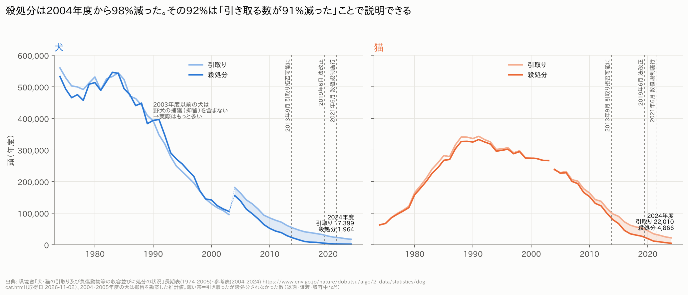

- **結論：殺処分が減った分の92%は「引き取る数が減ったこと」で説明できます（計算）。** 2004年度と同じ割合で殺処分を続けていたと仮定して計算しました。
  - 犬：引取り −90.4%、殺処分 −98.7%
  - 猫：引取り −90.7%、殺処分 −98.0%
- **2013年9月以降、減り方が速くなりました。** 自治体が飼い主・業者からの引取りを断れるようになった時期です。
  - 飼い主からの引取りは、2012年度→2014年度の2年で犬が53%減、猫が49%減りました。
  - 飼い主のいない犬猫の引取りは、同じ期間で犬17%減・猫23%減にとどまります。
  - 年あたりの減り方は、殺処分が年−11%（2004→2012年度）から年−23%（2012→2024年度）に速まりました。
- **断った件数は、国の統計にありません。**

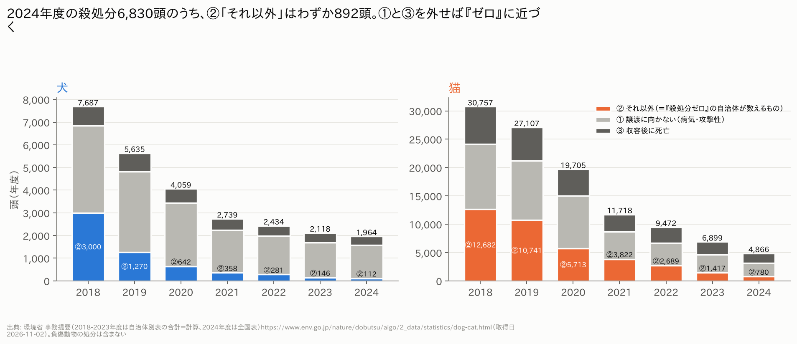

- **「殺処分」の中身は3つに分かれています（2018年度から）。**
  - ① 譲渡に向かない（病気・攻撃性など）
  - ② それ以外
  - ③ 収容した後に死んだ
- **2024年度の6,830頭のうち、②は892頭（13%）だけです。** 犬は②が112頭（6%）、猫は780頭（16%）です。
- **国の目標（2030年度に半分）も、主に②を減らす目標です。** ②は2018年度から94%減りましたが、①と③の合計は74%減でした。
- **自治体の「殺処分ゼロ」は数え方しだいです**（`clean/殺処分ゼロ_自治体定義.csv`）。
  - **東京都**：①と③を「殺処分」に数えていません。2024年度も151頭を致死処分しています（動物福祉による60頭＋収容後の死亡91頭）。
  - **神奈川県**：
    - 「安楽死」と「収容中の死亡」を別に数えています（2024年度は犬7頭・猫10頭）。
    - 横浜・川崎・横須賀の3市は県のセンターの対象外です。
    - 路上でけがをした猫は獣医師会に任せており、そこで安楽死した猫は県の数に入りません。

### ② 売れ残りゼロ：値下げされ、生後半年を過ぎると店頭から消える（L）

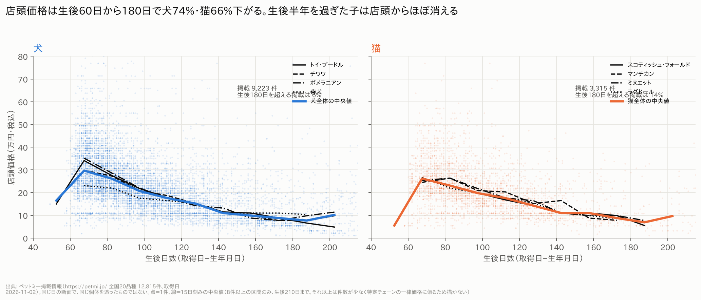

- **店頭価格は生後60日から180日の間に、犬で74%・猫で66%下がります（中央値、計算）。** 対象は、取得日に掲載されていた全国20品種です。品種別では次のとおりです。
  - 下がり方が大きい：ヨークシャー・テリア 83%、ポメラニアン 78%、トイ・プードル 76%
  - 下がり方が小さい：柴犬 52%、MIX 46%
  - 猫は 61〜69%
- **生後180日を超える掲載は、犬6%・猫14%しかありません。** 生後270日を超えると犬は0.9%です。
- **その先、どこへ行ったかは誰も報告していません。** 業者が自治体に出す報告では、家庭への販売、系列の別の店への移動、譲渡が、すべて「販売・引渡し」の1つの欄に入るためです。
- 注意：これは1日の断面です。同じ子を追いかけて調べたものではありません。ブリーダーナビは利用規約で自動取得が禁止されているため、取っていません。

### ③ 死亡率1%未満：「店に入ってから」だけを数えている（F）

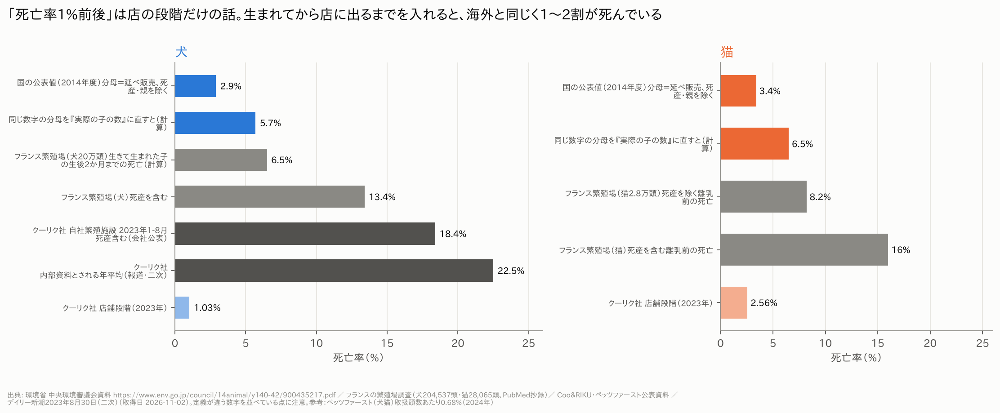

- **国が出した2014年度の死亡率は、犬2.9%・猫3.4%です。** ただしこの数字は、
  - 割る数が「延べ」です。延べとは、同じ子が繁殖業者から店へ、店から家庭へと動くたびに数える数です。
  - 死産を含みません。
- **割る数を実際の子の数（延べの半分と仮定）に直すと、犬5.7%・猫6.5%になります（計算）。** これはフランスの繁殖場20万頭の調査とほぼ同じです（生まれた後の死亡が犬6.5%、猫8.2%）。
  - つまり、日本の業者の死亡が少ないわけではありません。割る数を大きくして、死産を外しているから小さく見えています。
- **死産を入れると、2014年度だけで犬約2.6万頭が数字に出ていない計算です（推測）。** フランスの調査（死産7.4%）並みと仮定しました。
- **クーリク社の自社繁殖施設の死亡率は18.4%です**（2023年1〜8月、死産を含む、会社公表）。店の段階は1.03%です。

### ④ 業者数は横ばい：「3割廃業」は起きず、受け皿が増えた（G・H）

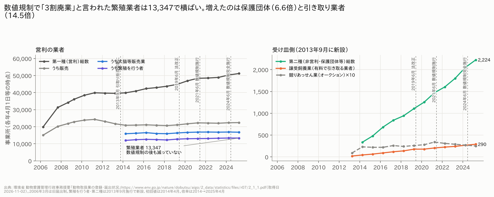

- **数値規制の前、業界は「犬の繁殖業者の32%が廃業を考えている」「13万頭の受け入れ先が必要」と警告しました。** 業界団体の2020年アンケートです。
- **実際の繁殖業者の数は、2021年4月→2025年4月で+2.3%（13,347）でした。** 警告どおりなら8,832程度になっていたはずです（推測）。
  - 登録の数は「事業所の数」で、「頭数」ではありません。1か所あたり何頭減ったかは、国に数字がありません。
- **増えたのは受け皿の方です。**
  - 保護団体などの届出：336（2014年）→ 2,224（2025年）
  - 有料で引き取る業者：20（2013年）→ 290（2025年）

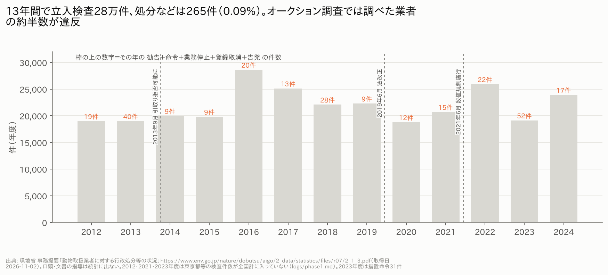

- **立入検査は13年間で28.4万件ありましたが、勧告・命令・業務停止・登録取消・告発は合計265件（0.09%）です。**
- **一方、国のオークション調査でブリーダー約1,400か所を調べると、約700か所（約5割）に違反がありました。**
  - 内訳は、帳簿の不備496件、生後8週を守っていない50件などです。
  - 調査先は「生年月日の曜日に不自然な偏りがある業者」から選ばれています。無作為ではありません。

### ⑤ 需給ぴったり：犬は「ほぼ合う」が、業者の数とは合わない（B・C・D・E）

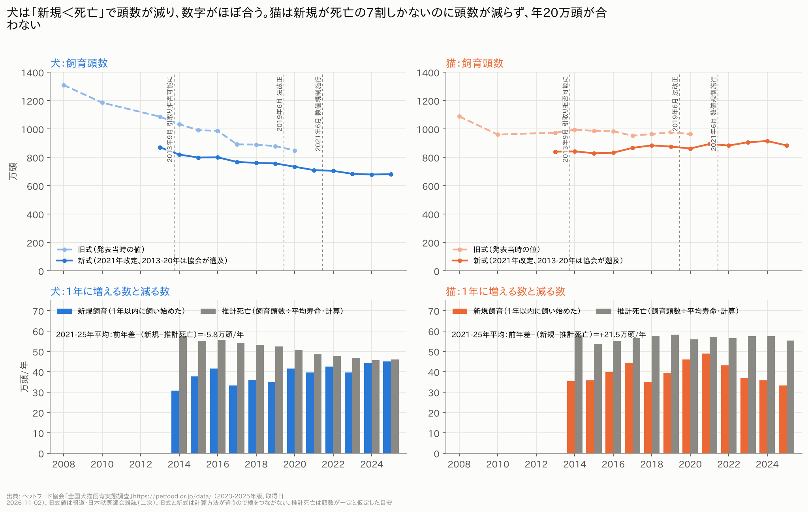

- **犬（D）：新しく飼われる数（約42万頭/年）より、死ぬ数（推計約47万頭/年）が多く、頭数は実際に減っています。** 3つの数字のずれは年5.8万頭で、だいたい合います。

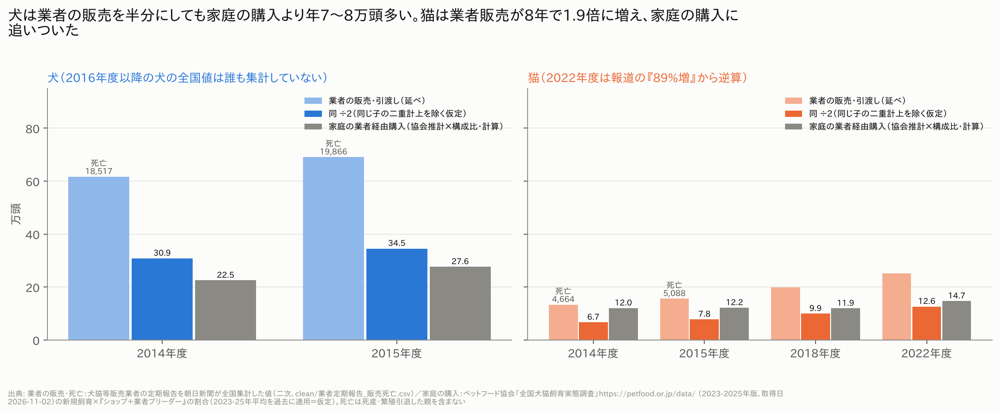

- **しかし業者の数と並べると合いません（B）。**
  - 2014年度、業者の販売（延べ）は61.7万頭でした。半分にしても30.9万頭です。
  - 家庭が業者から買った数は22.5万頭（計算）です。
  - **差は年8.3万頭（2015年度は6.9万頭）です。**
  - 延べを家庭の購入に合わせるには、2.5〜2.7で割る必要があります。業者が出す報告の「販売・引渡し」には、系列の店への移動や繁殖を引退した親も入るためです。

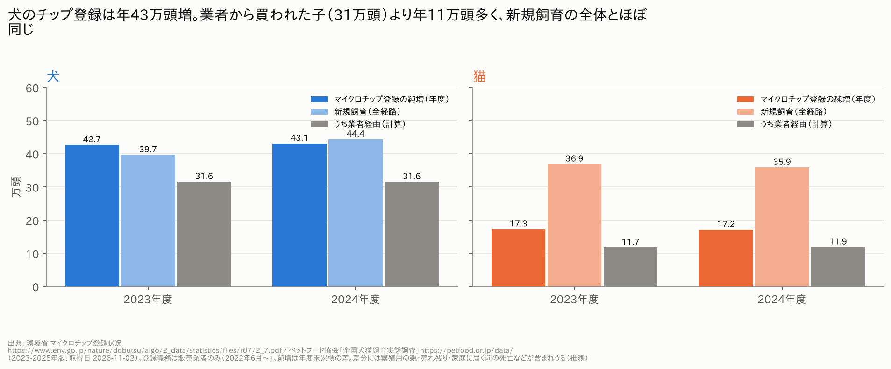

- **マイクロチップ（C）：犬の登録は1年で43万頭増えました。** これは新しく飼われた犬の全体（40〜44万頭）とほぼ同じです。
  - 登録の義務があるのは業者から来た子だけで、その数は約31.6万頭（計算）です。
  - **差は年11万頭です。** 繁殖用の親、売れ残り、家庭に届く前に死んだ子も登録されている可能性があります（推測）。国は「新しく登録された数」と「死亡の届出数」を分けて公表していないため、確かめられません。

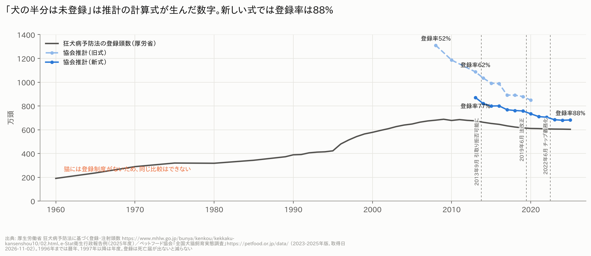

- **狂犬病の登録（E）：「犬の半分は登録されていない」とよく言われてきました。**
  - 古い計算式の推計（2008年は1,310万頭）で割ると、登録率は52%です。
  - 2021年に改めた計算式（2025年は682万頭）で割ると、88%です。
  - **「半分」は、推計の式が生んだ数字でした。**
  - 一方、狂犬病の新規登録（2024年度 51.1万頭）は、協会の新規飼育（44.4万頭）より15%多くなっています。
  - 猫には登録制度がないため、同じ確認はできません。

### 競り（オークション）：大手の自称だけで国の数字にほぼ届く（K）

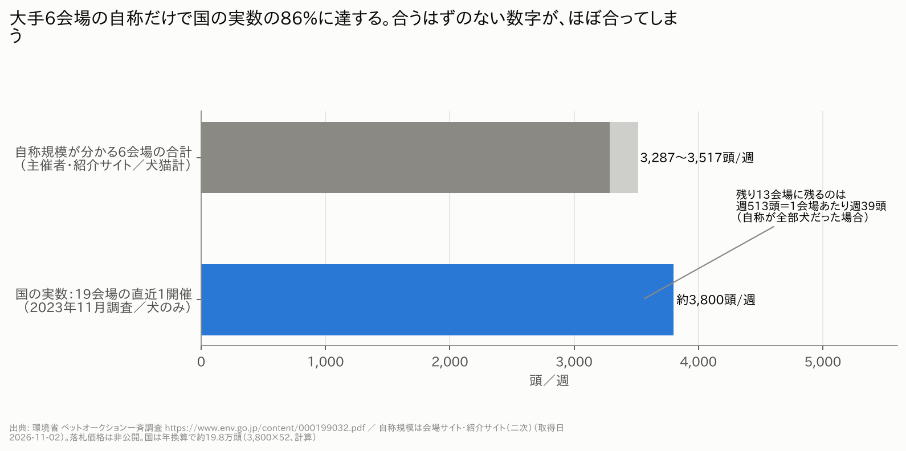

- **規模が分かる大手6会場の自称（犬猫合わせて週3,287頭以上）だけで、国が数えた19会場の犬の数（週約3,800頭）の86%に達します。** 残り13会場に残るのは、1会場あたり週39頭です（自称がすべて犬だった場合）。
  - 自称が大きすぎるか、国の数え方（各会場の直近1回分）が小さく出ているかのどちらかです。週2回開く会場は、国の数では少なく出ます。
- **落札価格は公開されていません。**
- **追加資料（2026-11-03取得）：業界団体の会長講演でも、同じ規模が語られています。** ペットパーク流通協会（PPA）の会長が2021年12月の講演で話した内容です（[講演録PDF](https://www.j-pets.jp/summit20211202/04.pdf)、業界団体の発言なので二次扱い）。
  - 「国内の年間流通頭数は40万頭ほど。そのうち約半数が、全国15か所の加盟会場を通る」→ 約20万頭/年。国の調査の年換算（19会場で約19.8万頭、計算）とほぼ同じです。
  - 「40万頭」は、2015年度の業者の販売（延べ）犬猫84.7万頭を半分にした42.4万頭とも近い数字です（計算）。
  - 関東ペットパークは「通常1回800頭、多いときで1,000頭」。関東・B&Bの2会場では、13か月で54,643頭にマイクロチップを付けています（週約1,000頭）。
  - 関西ペットパークの公式サイトには頭数の記載がありません（毎週月曜開催、手数料は売価の5%）。関東・B&Bの公式サイトは今回も接続エラーで取れませんでした。
  - 同じ会場のサイトには、2022年に国税局がオークション運営2法人とブリーダー6人の申告漏れを指摘したという報道への反論が載っています。報道では、ブリーダーが「販売数を実際より少なく見せかけていた」とされています。**業者が出す販売数そのものが、少なめに報告されている可能性がある**、という新しい論点です（報道ベース、未確認）。
  - 数字は `clean/オークション_追加資料.csv` にまとめました。

## 5. 犬と猫で違う点

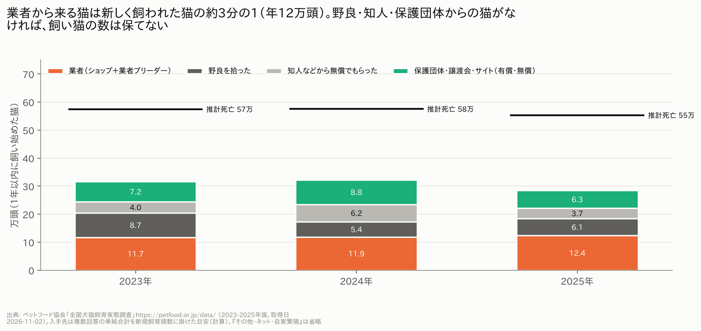

- **猫は野良が供給を埋めています（J）。**
  - 1年以内に飼い始めた猫のうち、野良を拾った猫は15〜24%（年5〜9万頭）、知人から無償でもらった猫が年4〜6万頭です。
  - 業者から来る猫は約12万頭/年で、全体の約3分の1です。
  - 野良を拾った猫を除くと、「新しく飼う数−死ぬ数」は年−27〜−29万頭になります（計算）。
  - 犬の野良拾いは0%で、犬の供給はほぼ業者だけです。
- **猫は業者の供給が倍近くに増えました（I）。**
  - 業者の販売（延べ）：13.4万頭（2014年度）→ 25.2万頭（2022年度、+89%）
  - 新しく飼われた猫：+22%
  - 需要の伸びを超えて増えた分は、年約4.5万頭です（推測）。
- **猫の頭数の収支は合いません（D）。**
  - 新規は年約40万頭、推計死亡は年約57万頭です。それなのに飼い猫の数は横ばいで、年21.5万頭が説明できません。
  - 協会の推計の範囲（外で餌をもらう猫の扱い）や、平均寿命の数え方の問題かもしれません。
- **猫が増えて困っているのは、保護する側です。**
  - 120団体の直近1年で、新しく保護したのは8,718頭、譲渡したのは7,652頭、看取ったのは755頭（看取り率8.7%）です。
  - 引き受けが送り出しを上回って抱え込んでいる団体が48.3%あります。
  - 1頭を譲渡するまでの費用は平均9.6万円です。里親から受け取るのは3〜4万円です。
  - 猫の主な保護経路は「野良猫」が76%です。（犬猫生活 実態白書2026、アニマル・ドネーション白書2025）
- **猫には登録制度がありません。** 狂犬病の登録は犬だけです。マイクロチップの義務も業者から来た子だけです。

## 6. 国が持っていない数字と、埋める方法

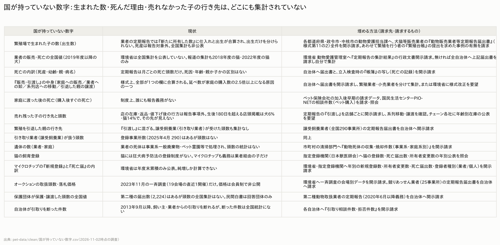

- **すぐにできる開示請求は次の4つです。**
  1. **全国の都道府県・政令市・中核市の動物愛護担当課に、業者の「動物販売業者等定期報告届出書」（様式第11の2）を全件請求する。**
     - 犬の2019年度以降の販売・死亡の全国値は、誰も集計していません。集めれば、この空白を埋められます。
     - 繁殖業者と小売業者を分けて数えれば、「延べ」がふくらむ理由も確かめられます。
  2. **環境省と、マイクロチップの登録機関（日本獣医師会）に、年ごとの内訳を請求する。** 新規登録数、所有者の変更数、死亡の届出数、登録した人が業者か個人か、の4つです。図7の「11万頭の差」の中身が分かります。
  3. **環境省に、オークション一斉調査の会場別データを請求する。** 図9の「自称と実数のずれ」がどの会場で起きているかが分かります。
  4. **各自治体に、引取りの相談件数と断った件数を請求する。** 図1の「引取りが減った」のうち、断った分がいくつかが分かります。
- **一覧の元データ**は `clean/国が持っていない数字.csv` です。

## 7. できたこと／できなかったこと

**できたこと**

- 殺処分・引取り：犬猫別、1974〜2024年度の全年度。都道府県別（2009〜2024年度）は、市を県に足した版と分けた版の両方を作りました。
- 殺処分の3つの内訳（2018〜2024年度）。
- 業者の登録数（2006〜2025年）、立入検査と処分（2009〜2024年度）。
- 狂犬病の登録（1960〜2025年度）、マイクロチップ（2022〜2024年度）。
- 協会の飼育頭数：新しい式（2013〜2025年）と古い式（2008・2010・2013〜2020年）を別々の列にしました。
- 店頭価格：12,815件。
- オークション調査、海外の死亡率、保護団体の数字、チェーン各社の公開状況。
- A〜Lの計算すべてと、図14枚。

**できなかったこと**

- **環境省の年報の平成21年度版以前**：ネットに見当たらず、Wayback Machineにもこの環境から接続できませんでした。このため、引取りの内訳（飼い主から／飼い主不明）は2010年度からしかありません。
- **ペットフード協会の2013〜2022年版のPDF**：すべて削除されていました。入手先の構成と価格は2023年からしかなく、過去の年には2023〜25年の平均を当てはめました（仮定）。
- **業者の販売・死亡**：犬は2014・2015年度しか取れませんでした。2016・2018・2022年度は取得失敗、2019年度以降は存在しません。元になる新聞記事の一部が削除されていました。
- **ブリーダーナビ**：利用規約で禁止されているため取りませんでした。業者のブリーダーから直接買う場合の価格は比べられていません。
- **関東・B&Bペットパーク、コジマ、ワンラブ、かねだい、アミーゴの公式情報**：取得失敗です。オークションの自称規模の一部は二次情報です。
- **熊本市・札幌市の「殺処分ゼロ」の定義**：一次資料を確認できませんでした。

（GitHubへのpushは2026-11-03に成功。経緯は log.md の先頭を参照）

## 8. 数字を使うときの注意

- **「延べ」**：同じ子が動くたびに数える数です。業者の販売・引渡しは延べなので、家庭が買った数とは比べられません。系列の店への移動、繁殖を引退した親、譲渡も入っています。
- **古い式と新しい式**：協会の飼育頭数は2021年に計算式が変わりました（単身世帯と2人以上の世帯を分けて推計）。2013〜2020年は新しい式で計算し直した値もあります。古い式の値と1本の線でつないではいけません。
- **殺処分の①②③**：「殺処分ゼロ」と言うときは、どの分類を除いているかを必ず確認してください。国の統計は①②③すべてを含みます。
- **提出率**：業者の報告は全員が出しているわけではありません（2022年度は84.6%）。
- **年度と暦年**：環境省・業者の報告は年度（4月〜翌3月）、協会は暦年（10月ごろの調査）です。半年ずれます。
- **2003年度以前の犬の引取り・殺処分**：野犬の捕獲を含まないので、2004年度以降と単純には比べられません。
- **協会の数字はアンケートの推計です。** 新規飼育の入手先は複数回答なので、合計しても100%になりません。

---

## 図の一覧

| 番号 | ファイル | 伝えたいこと |
|---|---|---|
| 1 | charts/01_殺処分と引取りの長期推移.png | 殺処分の減少は引取りの減少で説明できる |
| 2 | charts/02_殺処分の分類内訳.png | ②は892頭だけ |
| 3 | charts/03_動物取扱業の登録数.png | 繁殖業者は減らず、受け皿が増えた |
| 4 | charts/04_飼育頭数_新規_推計死亡.png | 犬は合い、猫は合わない |
| 5 | charts/05_狂犬病登録と協会推計.png | 「半分未登録」は推計式の産物 |
| 6 | charts/06_業者販売と家庭購入.png | 犬は業者の方が年7〜8万頭多い |
| 7 | charts/07_マイクロチップ純増と購入.png | チップは業者から買われた数より11万頭多い |
| 8 | charts/08_店頭価格の値下がり曲線.png | 60→180日で犬74%・猫66%下落 |
| 9 | charts/09_オークション自称vs実数.png | 自称6会場で国の実数の86% |
| 10 | charts/10_AからLのまとめ.png | A〜Lのまとめ表 |
| 11 | charts/11_国が持っていない数字.png | 国が持っていない数字と埋め方 |
| 12 | charts/12_立入検査と処分.png | 検査28万件で処分265件 |
| 13 | charts/13_死亡率の比較.png | 1%は店の段階だけ |
| 14 | charts/14_猫の新規飼育の入手先.png | 猫の業者供給は3分の1 |

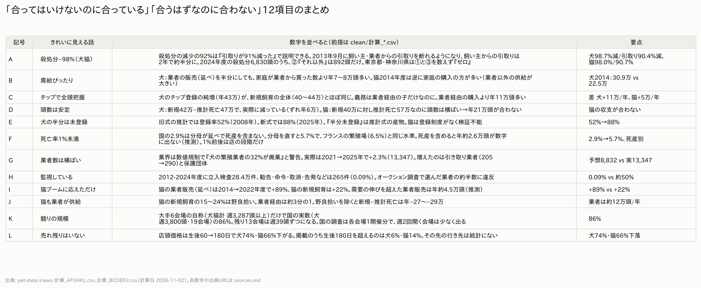

---

## 最終チェックリスト

- [x] 殺処分の長期推移が犬猫別・全年度で入っている（1974〜2024年度。内訳は2009年度〜）
- [x] 分類①②③の内訳が入っている（2018〜2024年度）
- [x] 登録数（第一種/繁殖/第二種/譲受飼養/競り）が全年度入っている（2006〜2025年。繁殖・第二種は制度ができた2014年から）
- [x] 飼育頭数が旧式・新式別に入っている（旧式の2009・2011・2012年は取得失敗）
- [ ] 業者の販売・死亡が公表年度分すべて入っている → **一部のみ**。犬の販売は2014・2015年度、猫は2014・2015・2018・2022年度。他は取得失敗または存在しない
- [x] 狂犬病登録が入っている（新規登録の1997〜2004年度は取得失敗）
- [x] マイクロチップが入っている
- [x] 店頭価格の値下がり曲線が犬猫で入っている（ペットミーのみ。生後365日の件数は少ない）
- [x] オークションの自称 vs 実数が入っている
- [x] 保護側の数字（団体数・保護・譲渡・看取り・滞留・費用）が入っている
- [x] A〜Lの計算が全部、前提付きで入っている（clean/計算_*.csv の「前提」列）
- [x] 猫の項目が犬と同じ数だけある（ないものは「猫には制度がない」などと書いてある）
- [x] 全グラフに注記線と出典がある（出典は全14枚。注記線は年の推移を線で描いた図1〜5・12の6枚。図6・7は取れた年度だけの棒グラフ、図8〜11・13・14は断面・表なので入れていない）
- [x] できたこと／できなかったことが分かれている
